<h1 align="center">Air75 Split</h1>

<p align="center"><b>A 70-key wireless keyboard that snaps together on magnets, or pulls apart into a split.</b><br>
8 mm case · animated OLED on each half · handwired, no PCB · every part prints with no supports</p>

<p align="center">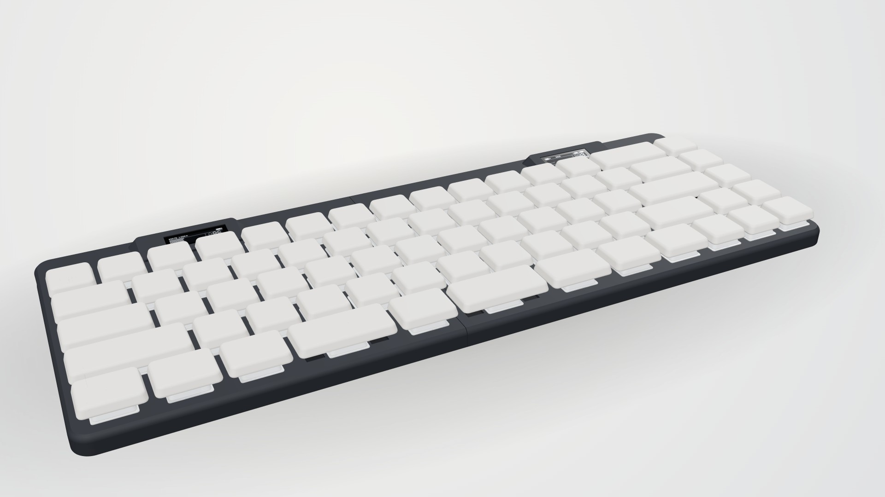</p>

<p align="center">
  <a href="docs/BUILD.md"><b>Build guide</b></a> ·
  <a href="models/print"><b>Print files</b></a> ·
  <a href="firmware"><b>Firmware</b></a> ·
  <a href="viewer/index.html"><b>3D viewer</b></a> ·
  <a href="bom/index.html"><b>Parts list</b></a>
</p>

| **Layout** | 70 keys, 65 % (an Air75 without its function row), 30 left + 40 right |
|---|---|
| **Size** | 310 × 119.5 mm joined |
| **Thickness** | 8.0 mm case, 16.4 mm on the desk with keycaps |
| **Switches** | Gateron KS-33 low profile 2.0 |
| **Brains** | 2 × SuperMini nRF52840, ZMK over Bluetooth, right half talks to the computer |
| **Screens** | 2 × 0.91" 128 × 32 OLED with custom animated firmware |
| **Power** | 2 × 3.7 V LiPo, 48 × 14 × 5.1 mm, one per half |
| **Extras** | snap-on travel covers, magnetic tenting wedges (5° / 10° / 15°) |

## The screens

Each half has a 0.91" OLED in a printed pod tilted 10° toward you. They run custom firmware, not ZMK's stock status screen.

<p align="center">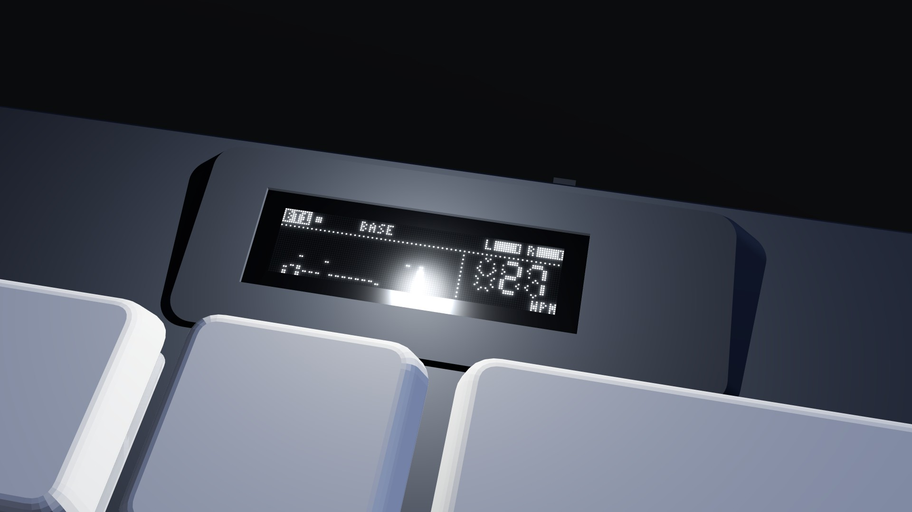</p>

<p align="center">
  
  
</p>

- **Right:** spectrum bars that jump where you type, a big seven-segment WPM counter, Bluetooth profile, layer and both batteries.
- **Left:** a live map of its 30 keys with ripples from every press, the link to the right half and its battery.
- The screens only redraw while something moves, and switch off when the keyboard sleeps. The 3D viewer runs the same drawing code: a check runs the C and the JavaScript on one typing session and compares every frame byte for byte.

## Joined or split

<p align="center">
  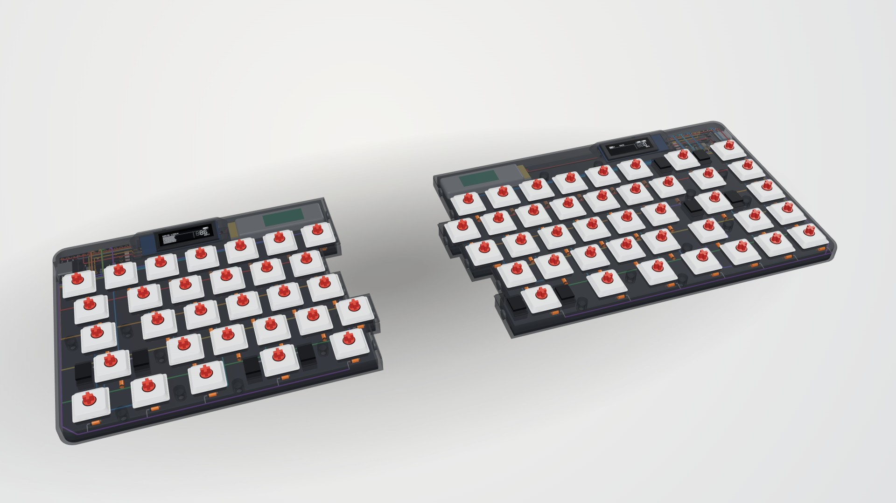
  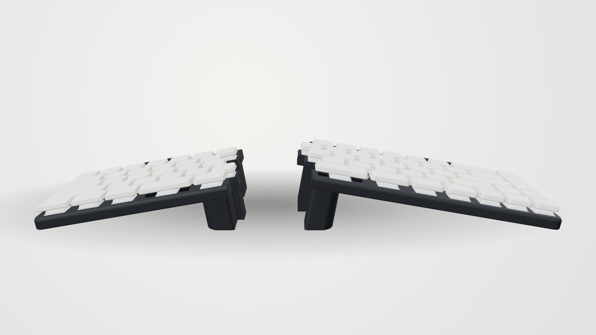
</p>

- The halves meet on a staircase seam that follows the key edges, held by 6 pairs of magnets with a tongue and groove to keep them level. Joined, only a hairline shows.
- Split them and clip on a magnetic tenting wedge: 5° / 10° / 15°. Each wedge sockets over the rubber feet so it can't slide, and its magnets are hidden in the base.

## Slim

<p align="center">
  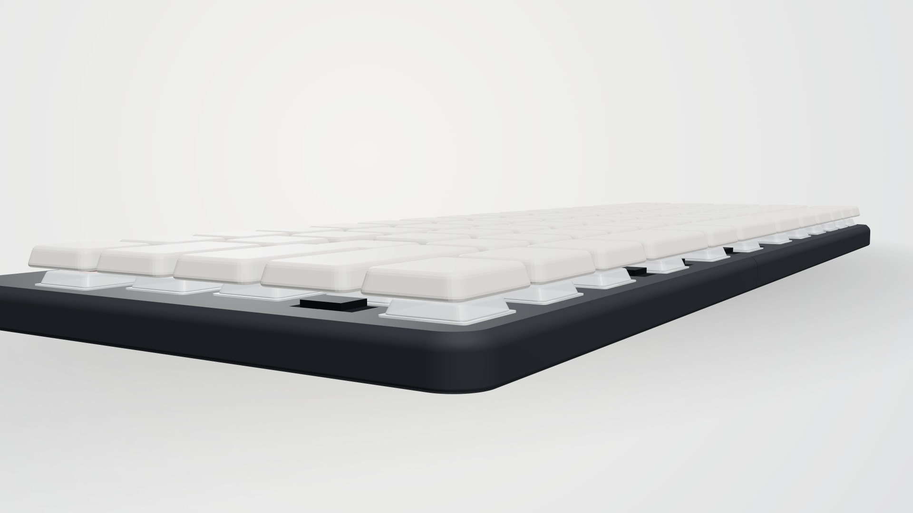
  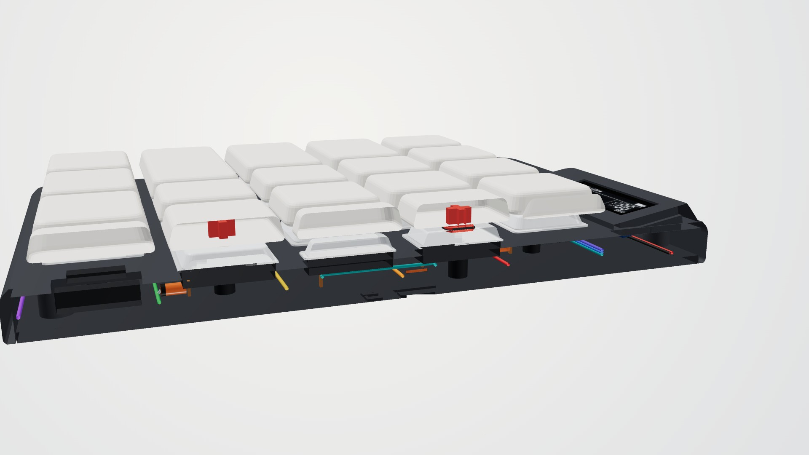
</p>

1.6 mm base, 5.2 mm inside for wires, diodes, battery and controller, 1.2 mm switch plate: **8.0 mm** in all, with a 2.5 mm rounded edge. The battery sits in a pocket in the base and the controller lies flat beside the screen.

## Inside

<p align="center">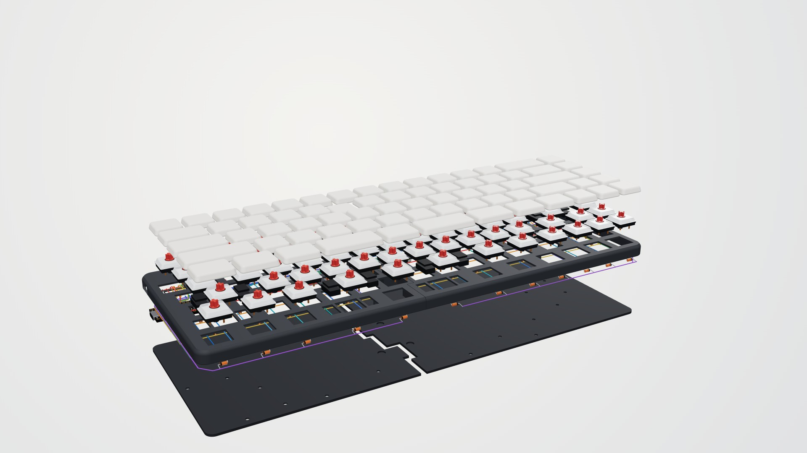</p>

<p align="center">
  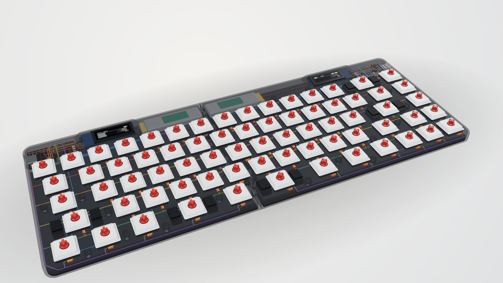
  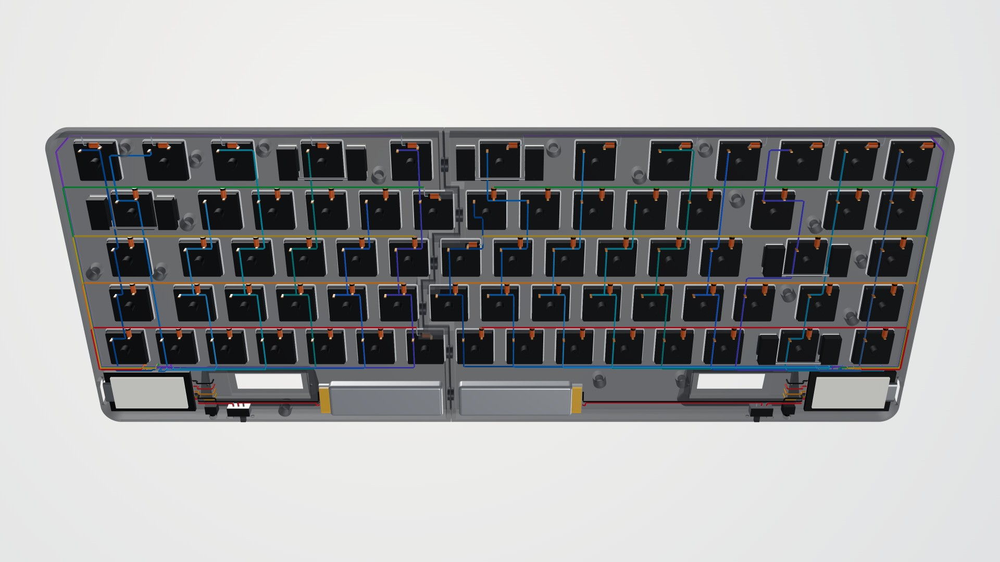
</p>

Every wire and diode has a real 3D route, checked against every switch, post, screw, the battery, the controller and the walls: no collisions on either half. The [wiring sheets](docs/images/wiring_left.png) show them all, ready to solder.

## Travel covers

<p align="center">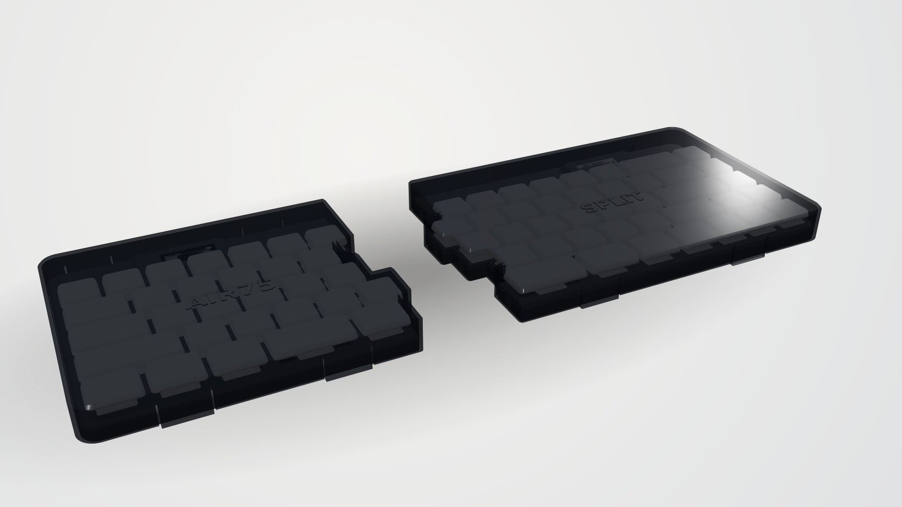</p>

Smoke PETG covers snap on over the keys for the bag. The top clears the keycaps by 1 mm, so nothing gets pressed and the board stays asleep. Four flexible tabs hook under the case edge.

## Colours

<p align="center">
  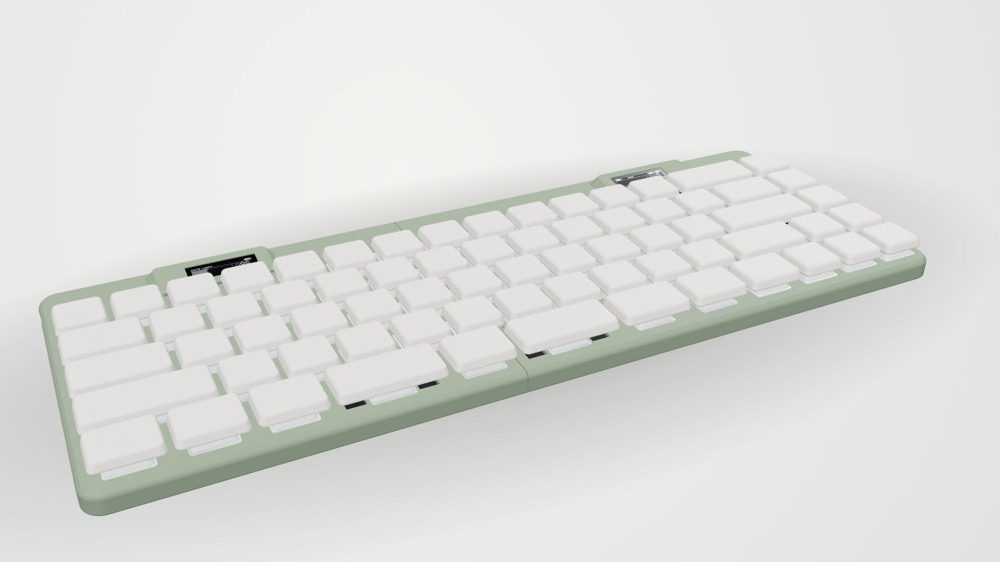
  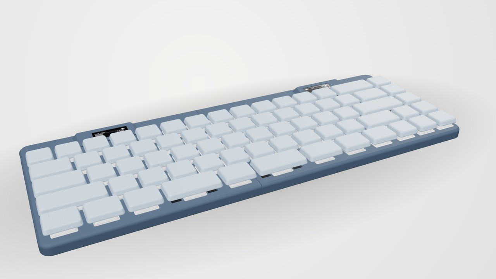
  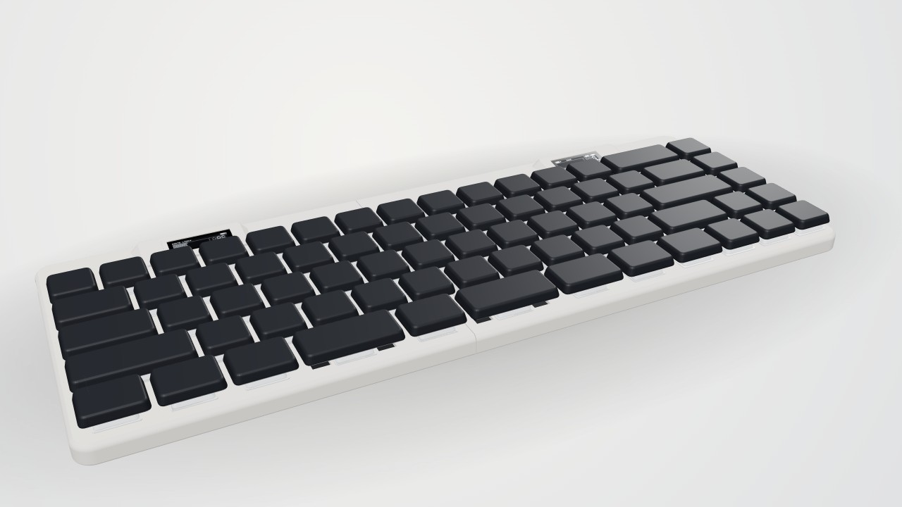
</p>

<p align="center">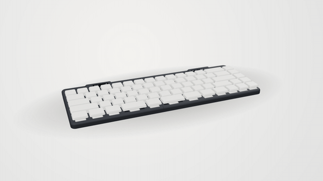</p>

## Build one

1. **Print:** everything in [`models/print/`](models/print) is already the right way up and needs no supports. Start with the fit-test plate.
2. **Buy:** the [parts list](bom/index.html) (about 20 parts, all common), or the table in the [build guide](docs/BUILD.md#parts-both-halves).
3. **Wire:** follow the [wiring sheets](docs/images/wiring_left.png): 7.7 m of 30 AWG wire and 70 diodes.
4. **Flash:** drop the ready-built `.uf2` files from [`firmware/`](firmware) on each half.

The [build guide](docs/BUILD.md) has the full details: layout, Fn layer, screens, covers, tenting, thickness, printing, wiring pins, firmware and assembly.

To see it in 3D, download [`viewer/index.html`](viewer/index.html) and open it in a browser. You can orbit, explode it, see inside, type on it and watch the screens, try colours and tenting, and export images.

## What's in the repo

```
cad/                 Python that generates everything: edit geom.py or layout.py and run make
models/print/        every part, already turned the way it goes on the bed: open in the slicer and print
models/stl/          the same parts in their assembled position
models/step/         the same parts as STEP, for any CAD program
firmware/*.uf2       ready-built firmware: left half, right half, settings reset
firmware/zmk-config/ firmware source (ZMK v0.3): keymap, shield, the animated screens in src/air75_oled/
viewer/index.html    the 3D viewer (open it in a browser); viewer/render.js makes the images in docs/images/
bom/index.html       the interactive parts list
docs/BUILD.md        the full build guide
docs/images/         renders, OLED previews, top views, wiring sheets, thickness section
```

Rebuild everything after a change (Python 3.11+, `pip install -r requirements.txt`):

```
make            # models, checks, drawings, docs and the viewer (about a minute)
make renders    # the images in docs/images (needs node, Playwright and ffmpeg)
```

`make` stops if a check fails. It checks every part is watertight and prints with no supports, that the STEP files match the STLs, that no wire or diode collides with anything (on both halves), and that the screens' C code and the viewer's JavaScript copy draw identical frames.

## Status

The design is complete and checked in software: the models, wire routes, print orientation and firmware all build and pass their checks. **Nobody has built one yet**, so the first build is the real test. Print the fit-test plate first.
