<p align="center">
  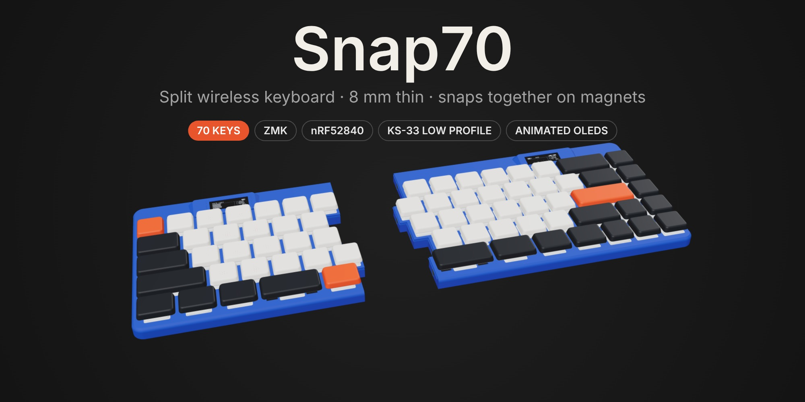
</p>

<p align="center">
  
  
  
  
  
</p>

<p align="center">
  <a href="docs/BUILD.md"><b>Build guide</b></a> ·
  <a href="#gallery"><b>Gallery</b></a> ·
  <a href="#the-screens"><b>Screens</b></a> ·
  <a href="models/print"><b>Print files</b></a> ·
  <a href="firmware"><b>Firmware</b></a> ·
  <a href="bom/index.html"><b>Parts list</b></a> ·
  <a href="viewer/index.html"><b>3D viewer</b></a>
</p>

---

Most split keyboards stay split. This one doesn't have to. Snap70 is a 70-key, 65 % board in two halves that **snap together on magnets** into one 310 mm keyboard, and pull apart when you want a split. It's **handwired** (no PCB to order), **wireless** on both halves, and only **8.0 mm** from the table to the top of the plate.

Every part is generated from code. The case, covers, tenting wedges, wire routes, firmware pin map and the pictures on this page all come from the Python in [`cad/`](cad).

<p align="center">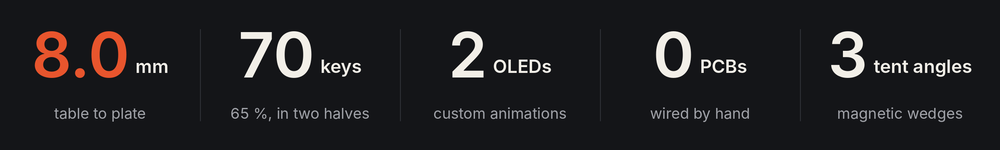</p>

<table>
  <tr>
    <td width="50%">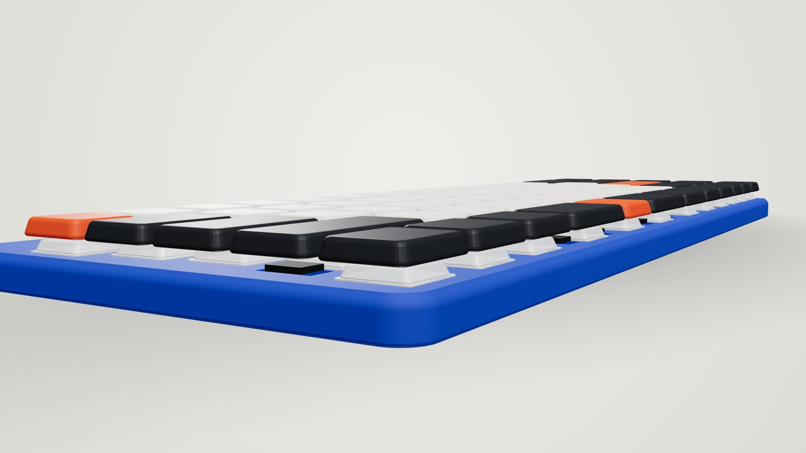</td>
    <td width="50%">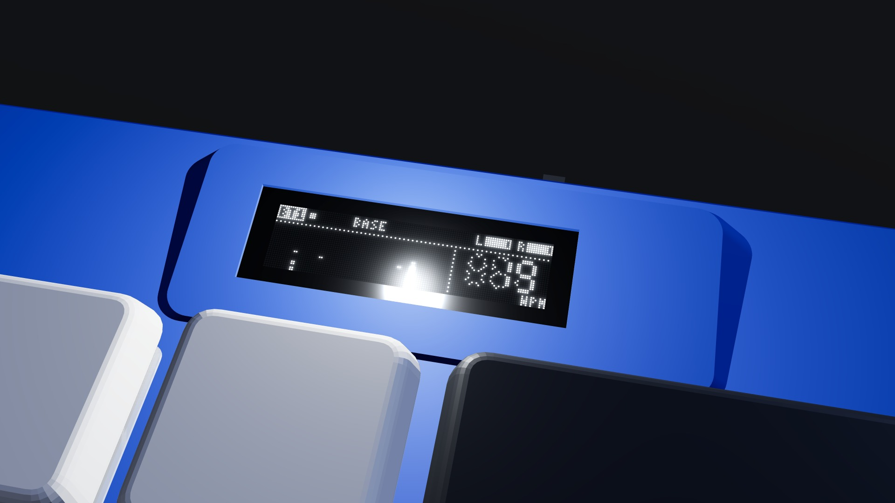</td>
  </tr>
  <tr>
    <td><b>8.0 mm</b> from the table to the top of the plate: a 1.6 mm base, 5.2 mm inside and a 1.2 mm plate, with a 2.5 mm rounded edge. 16.4 mm with keycaps.</td>
    <td><b>Animated screens.</b> A 0.91″ OLED on each half, tilted 10° toward you. The right one shows typing speed and spectrum bars, the left one a live map of its keys.</td>
  </tr>
  <tr>
    <td width="50%">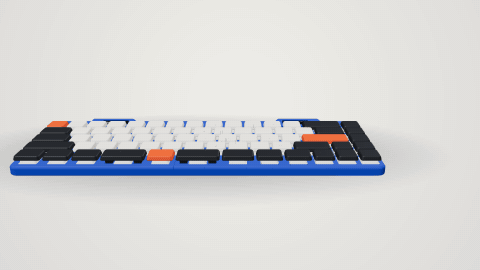</td>
    <td width="50%">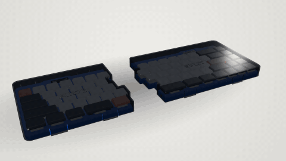</td>
  </tr>
  <tr>
    <td><b>Joined or split.</b> 6 magnet pairs and a tongue and groove hold the halves together. Pull them apart and clip on a magnetic tenting wedge: 5° / 10° / 15°.</td>
    <td><b>Travel covers.</b> Smoke PETG covers snap over the keys for the bag. They clear the keycaps by 1 mm, so nothing gets pressed.</td>
  </tr>
</table>

## Highlights

- **Wireless split:** a SuperMini nRF52840 in each half running [ZMK](https://zmk.dev). The right half talks to the computer; the left half talks to the right.
- **Snaps together:** the halves meet on a staircase seam that follows the key edges, so joined it reads as one board with a hairline between them.
- **Animated OLEDs:** custom firmware draws both screens. The 3D viewer runs the same drawing code, checked frame by frame against the C.
- **Tenting:** magnetic wedges at 5° / 10° / 15° that socket over the rubber feet. Their magnets hide inside the base. 5° lifts the inner edge 15 mm, 10° lifts the inner edge 31 mm, 15° lifts the inner edge 47 mm.
- **Prints with no supports:** every part, including the covers and the wedges, comes out of the slicer the right way up.
- **Wired by hand:** 7.7 m of 30 AWG wire and 70 diodes, each with a real 3D route checked so nothing collides.

## Specs

| | |
|---|---|
| Layout | Air75 without its function row: 70 keys, 65 %, 30 left + 40 right |
| Size | 310 × 119.5 mm joined |
| Height | 8.0 mm (1.6 base + 5.2 inside + 1.2 plate) · 16.4 mm with keycaps |
| Switches | Gateron KS-33 Low Profile 2.0 |
| Controller | SuperMini nRF52840 (nice!nano compatible) × 2 |
| Firmware | ZMK v0.3, custom shield and animated status screen |
| Screens | 0.91″ SSD1306 128 × 32 OLED × 2 |
| Battery | KP 551245 3.7 V LiPo × 2, 48 × 14 × 5.1 mm |
| Extras | snap-on travel covers, magnetic tenting wedges (5° / 10° / 15°) |

---

## Gallery

<p align="center">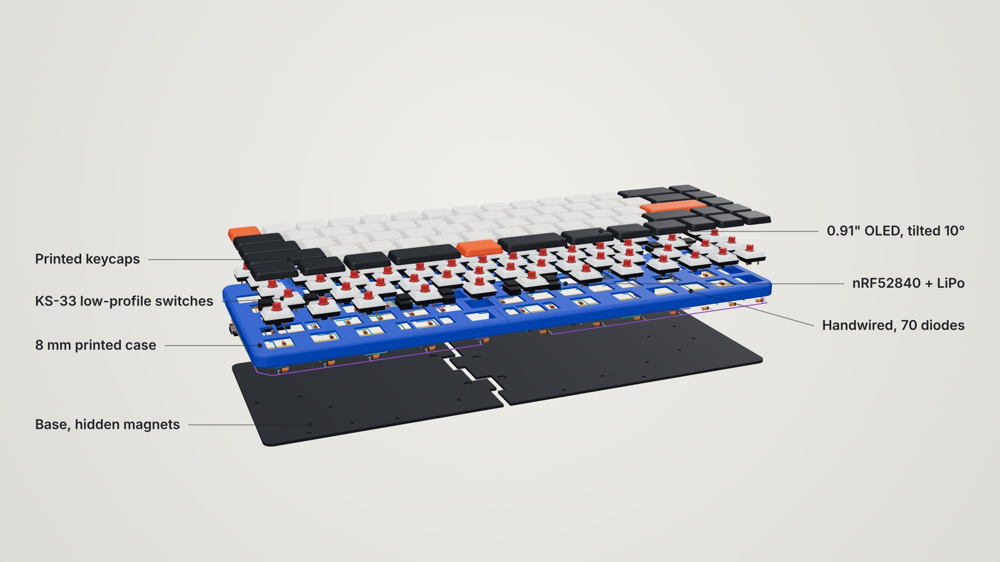</p>
<p align="center"><sub><b>Exploded.</b> Printed keycaps, KS-33 switches, the 8 mm case, hand-run 30 AWG rows and columns with 1N4148 diodes, the controller and battery, and the base.</sub></p>

<table>
  <tr>
    <td width="50%">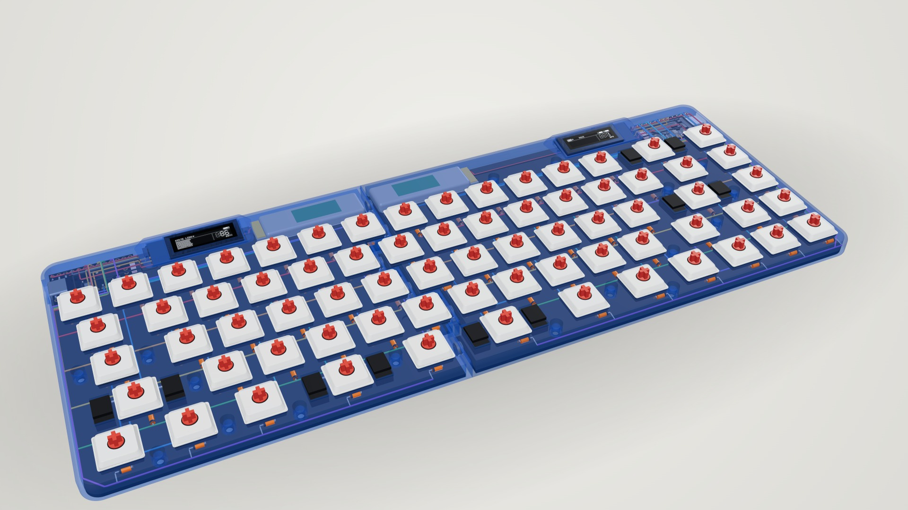</td>
    <td width="50%">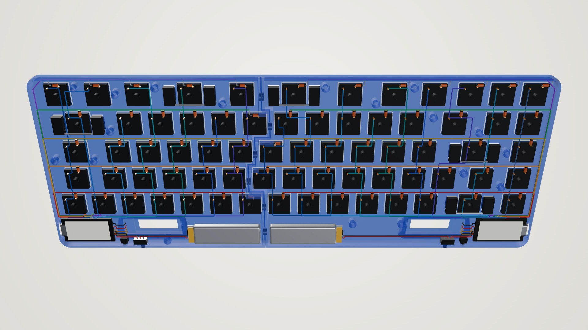</td>
  </tr>
  <tr>
    <td><sub><b>X-ray.</b> The controller, OLED and battery sit side by side in a bay behind the top row.</sub></td>
    <td><sub><b>Wiring.</b> Every wire and diode, routed and clearance-checked by <code>cad/routing.py</code>.</sub></td>
  </tr>
  <tr>
    <td width="50%">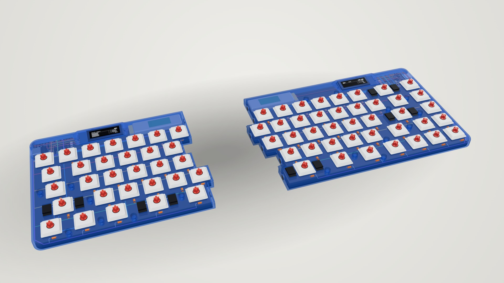</td>
    <td width="50%">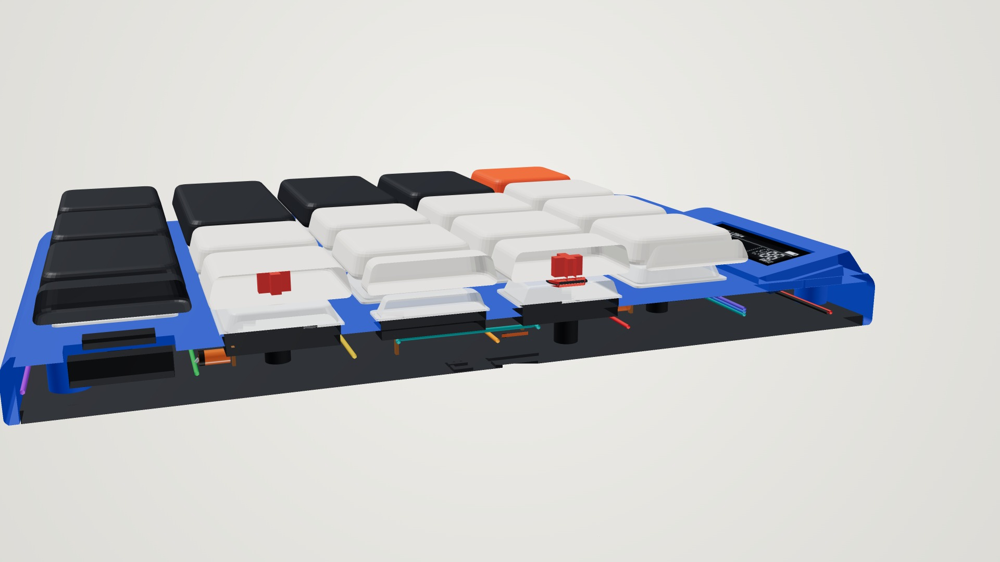</td>
  </tr>
  <tr>
    <td><sub><b>Apart.</b> 6 magnet pairs in the staircase seam, with a tongue and groove above them.</sub></td>
    <td><sub><b>Cutaway.</b> Switch, plate, wiring space and base, true to scale.</sub></td>
  </tr>
  <tr>
    <td width="50%">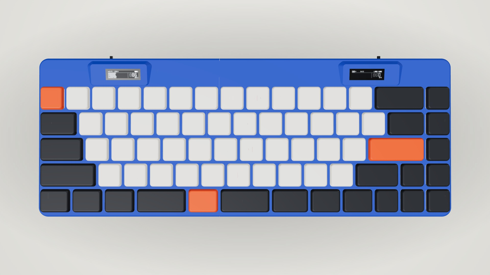</td>
    <td width="50%">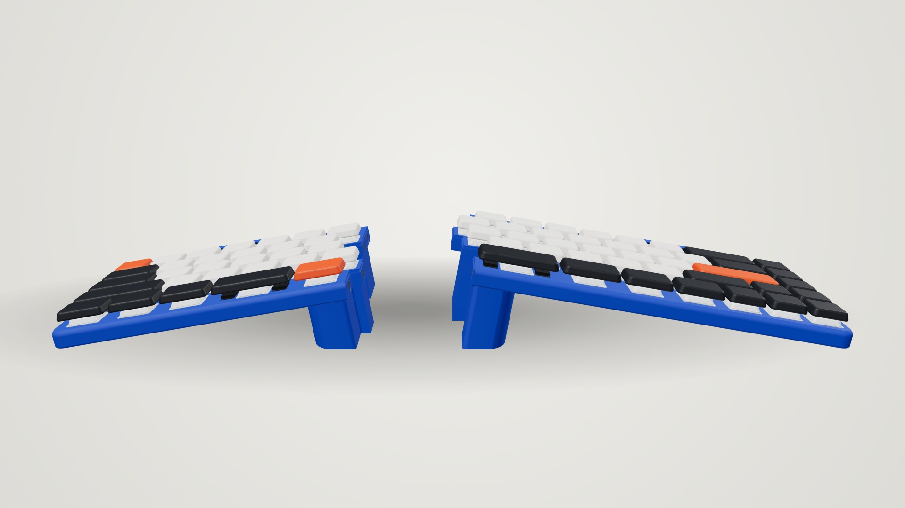</td>
  </tr>
  <tr>
    <td><sub><b>Top.</b> The Air75 layout without its function row, Fn on the left half.</sub></td>
    <td><sub><b>Tented at 10°.</b> Each half rests on its outer feet and the wedge.</sub></td>
  </tr>
</table>

### Pick your colours

Any filament works. These are a few colourways; the 3D viewer has more.

<p align="center">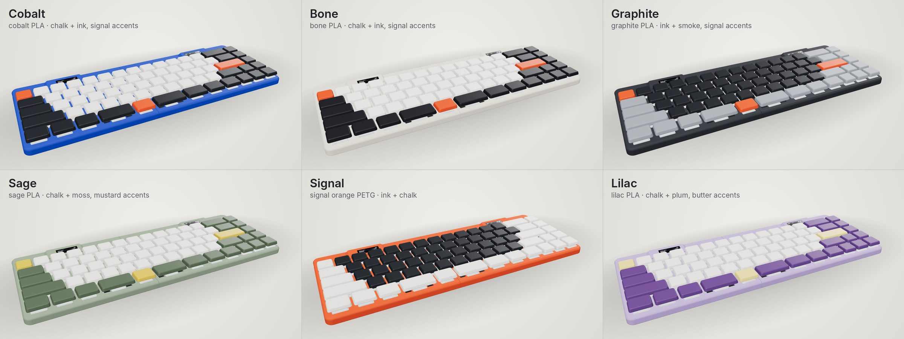</p>

---

## The screens


Both screens run custom firmware ([`firmware/zmk-config/src/air75_oled/`](firmware/zmk-config/src/air75_oled)), not ZMK's stock status screen.

- **Right half:** spectrum bars that jump where you type, with peak dots that fall; a big seven-segment WPM counter; Bluetooth profile, layer and both batteries.
- **Left half:** a live map of its 30 keys that light up as you press them, with ripples, the link to the right half and its battery.
- **Boot:** a short sweep across the screen.
- **Battery:** the screens only redraw while something moves, and switch off when the keyboard sleeps.

The 3D viewer runs the same drawing code ported to JavaScript, and a check runs both on one typing session and compares every frame byte for byte.


<br clear="right">

---

## Build one

The full step-by-step is in **[docs/BUILD.md](docs/BUILD.md)**. In short:

1. **Buy the parts:** all off the shelf. See the [parts list](bom/index.html) or the [table in the guide](docs/BUILD.md#parts-both-halves).
2. **Print the fit-test plate** in [`models/print/`](models/print) and adjust `SW_HOLE` if the switch is loose or tight.
3. **Print** the shells, bases and OLED pods, plus covers and wedges if you want them. No supports.
4. **Flash** the ready-built firmware in [`firmware/`](firmware) before closing anything.
5. **Wire** the matrix by hand from the [left](docs/images/wiring_left.png) and [right](docs/images/wiring_right.png) wiring sheets.
6. **Assemble:** controller, OLED, battery, then the screws and the magnets.

<p align="center">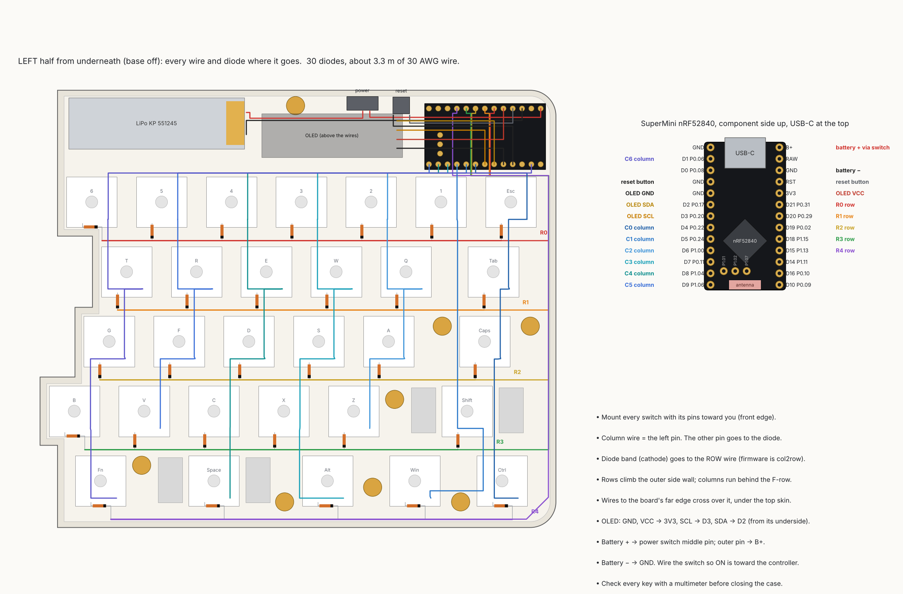</p>

## Keymap

```
|Esc| 1 | 2 | 3 | 4 | 5 | 6 |  ||  | 7 | 8 | 9 | 0 | - | = |  Bksp |Del|
| Tab | Q | W | E | R | T |  ||  | Y | U | I | O | P | [ | ] |  \  |PgU|
| Caps | A | S | D | F | G |  ||  | H | J | K | L | ; | ' | Enter  |PgD|
| Shift  | Z | X | C | V | B |  ||  | N | M | , | . | / |Shift | Up|End|
|Ctrl|Win |Alt | Space | Fn |  ||  | Space | Alt |Menu|Ctrl|Lef|Dow|Rig|
```

Hold **Fn** for F1–F12 on the number row, Bluetooth profiles on Q W E R, media on the arrows, and the bootloader on Backslash. The full Fn layer is in the [build guide](docs/BUILD.md#fn-layer). The keymap is [`air75_split.keymap`](firmware/zmk-config/boards/shields/air75_split/air75_split.keymap).

---

## What's in here

<details>
<summary><b>Repo map</b> (click to open)</summary>

```
├── models/
│   ├── print/        ready to slice, already the right way up (start with fit_test_plate)
│   ├── stl/          the same parts in their assembled position
│   └── step/         STEP solids for Fusion 360, Onshape, FreeCAD, SolidWorks
├── firmware/         ready-built .uf2 for each half, plus zmk-config/ (keymap, shield, animated screens)
├── cad/              Python that generates everything (parameters at the top of geom.py)
├── viewer/           interactive 3D viewer (index.html is one self-contained page) and the render scripts
├── bom/              interactive parts list
└── docs/             build guide, renders and drawings
```

Rebuild everything after a change (Python 3.11+, `pip install -r requirements.txt`):

```
make            # models, checks, drawings, docs and the viewer (about a minute)
make renders    # the pictures on this page (needs node, Playwright and ffmpeg)
```

`make` stops if a check fails: every part watertight and printable without supports, STEP files matching the STLs, no wire or diode colliding with anything, and the screens' C and JavaScript drawing identical frames.

</details>

## 3D viewer

[`viewer/index.html`](viewer/index.html) is a single page with the real case meshes inside. Download it and open it in a browser. In the viewer you can:

- Spin it any way, including underneath.
- Switch between **Built**, **Exploded**, **Inside**, **Wiring**, **Section**, **Apart** and **Covers** views.
- Tent the halves at 5° / 10° / 15°.
- Try case, keycap and screen colours, in day or night lighting.
- Type on your keyboard and watch the keys and both screens react.
- Save a PNG snapshot at up to 4K.

## Make it yours

Everything is parametric. Change a number in [`cad/geom.py`](cad/geom.py) or the layout in [`cad/layout.py`](cad/layout.py), run `make`, and the case, STEP files, covers, wedges, wire routes, firmware pin map, docs and viewer all follow.

## Status

The design is complete and checked in software. **Nobody has built one yet**, so the first build is the real test: print the fit-test plate first.

## Credits

- Layout after the **Air75** by NuPhy, without the function row.
- **[ZMK](https://zmk.dev)** firmware.
- Renders made with [three.js](https://threejs.org) in headless Chromium.
